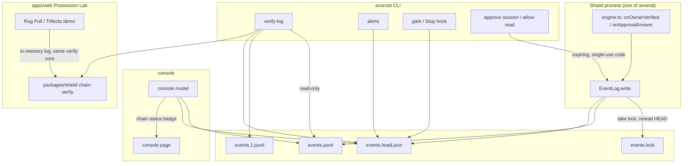

# Design Document: m12-audit-chain

## Overview

This feature adds a hash chain to the Shield's event log, a CLI command to verify it, visibility of the chain's head hash across the places the Shield already reports state, and a hardening pass on the Session Guard's one-time approvals so every approval decision is itself a chained event. It is detection, not prevention: a state folder's writer can still rewrite the whole log and head file together, and `docs/KNOWN_LIMITATIONS.md` says so.

## Research findings

### How `EventLog` appends today, and what stays true under the chain

Read from `packages/shield/src/events.ts` (header comment, `EventLog.write`, `rotate`):

- Every Shield process of a state folder opens its own file descriptor and appends with a single `writeSync` on an fd opened `O_WRONLY | O_APPEND | O_CREAT | O_NOFOLLOW`. POSIX guarantees that an `O_APPEND` write is atomic with respect to the end of the file across processes on the same local filesystem, so lines from different processes never interleave or overwrite each other. Each line is capped at `MAX_LINE_BYTES` (8 KiB).
- The file is bounded: past `maxBytes` (1 MiB) it is rotated to `events.1.jsonl` under a short-lived lock directory (`events.lock`, `mkdirSync` as the mutex, a stale lock older than 10 s is removed). If the lock cannot be taken and the file has already reached twice `maxBytes`, the event is dropped rather than written.
- Readers (`EventTail`) follow both files across rotation by inode/device identity and byte offset, tolerating truncation (treated as "start again") and skipping any line that is not valid JSON or does not match `ShieldEventSchema` (counted, never fatal).

**What this means for the chain.** The O_APPEND write guarantee means two processes never corrupt each other's bytes, but it says nothing about chain ordering: if two processes each read the current head, compute `seq = head.seq + 1`, and then append, both can compute the same `seq` and `prev` and race to write — the *bytes* land safely, but the *chain* now has two events claiming the same `seq`/`prev`, which `verify-log` would (correctly) report as broken even though nothing was tampered with. So the chain needs its own serialization step beyond the byte-level append guarantee.

### Multi-process append strategy for the chain

The existing rotation lock (`events.lock`, a `mkdirSync`-based mutex with staleness detection) is the one synchronization primitive `EventLog` already has, and it is reused rather than inventing a second lock:

1. Before computing `seq`/`prev`/`hash` for a line that is going to be chained, the writer takes the **same** lock directory used for rotation (`events.lock`), with the same stale-lock recovery (a lock older than `STALE_LOCK_MS` was left by a dead process and is removed).
2. Holding the lock, the writer re-reads the Head_File (not a cached in-process value — a sibling process may have advanced it), computes `seq = head.seq + 1` and `prev = head.hash` (or the Genesis_Value when there is no Head_File yet), builds the canonical record, appends the line with the existing `O_APPEND` write, then writes the new Head_File, then releases the lock.
3. The append and the Head_File write happen while the lock is held, so "read head → compute → append line → write head" is one critical section per event. This keeps the existing single-line, single-`writeSync` property (no change to how bytes land in `events.jsonl`) while making the *chain metadata* (`seq`, `prev`, the Head_File) strictly serialized across processes.
4. Rotation already uses the same lock, so chaining and rotation naturally exclude each other; a line's `seq` continues to increase monotonically across a rotation (the Head_File, not the file boundary, is the source of truth for the next `seq`).
5. The lock is held only for the compute-and-write step (microseconds), not for the lifetime of the process, so contention is brief. `EventLog.write` already tolerates failure without throwing (`this.fail(...)`, `this.problem`); if the lock cannot be taken within a short bounded number of attempts, the write proceeds **unchained** (no `seq`/`prev`/`hash`) rather than blocking the Shield — `verify-log` already has to tolerate unchained lines for old logs (AC-5), so a line dropped back to unchained form under contention degrades to "not chained from here," which is reported accurately rather than silently treated as broken.

### How `exorcist approve` and the OS release work today

Read from `packages/shield/src/os-auth.ts`, `packages/shield/src/session.ts`, `packages/shield/src/engine.ts`, `packages/shield/src/proxy.ts`, `packages/cli/src/commands/approve.ts`, `packages/cli/src/commands/on-access.ts` (`askOwner`, `personConfirms`, `confirms`):

- **OS release (`os` mode, macOS).** When the Session Guard holds a call under `sessionRelease: "os"`, the engine opens a ticket (`OWNER_PREFIX + n`) in `heldCalls` with `kind: 'os'` and emits a `verify-owner` action carrying a sanitized `Reason_Text`. `proxy.ts` runs this through `macOsAuth().verify(reason)` (`osascript -l JavaScript`, `LAContext`, policy 2, a 60 s timeout). The answer comes back to `engine.onOwnerVerified(ticket, verdict)`, which **deletes the ticket from `heldCalls` before doing anything else**, so a ticket cannot be answered twice: a second call with the same ticket id finds nothing and returns `[]`. `verdict === 'ok'` calls `afterOwnerVerified`, which re-runs `inspectCall` against the **current** state (`serverState(...).approvedHosts`, current policy) and only then decides to send, hold again under EX-016, or block — it is not an unconditional pass. This already satisfies AC-24 (single ticket, single use) and AC-27 (full re-check at release time); the design keeps this behavior and adds a property test pinning it, rather than changing it.

  **Gap found by the Property 6 tests (task 16.2), fixed in `engine.ts`.** `afterOwnerVerified` re-ran only `inspectCall` (secret and host checks). It did not repeat the first check of `onToolCall`, the `withheld` table. With `verifyCalls: false`, a tool that the agent re-listed while the OS prompt was open, and that was rug-pulled (EX-006) or poisoned in that listing, was withheld, yet `onOwnerVerified(ticket, 'ok')` still sent the held call. With `verifyCalls: true` the Shield's own `tools/list` before sending already caught it. `afterOwnerVerified` now refuses a call to a withheld tool, in enforce mode, before `inspectCall`, and records a `blocked` event. The other re-check cases needed no change: a secret or canary in the arguments is refused before any ticket exists, because arguments cannot change after the hold and canaries are fixed at Shield start.
- **Terminal release / `allow-read` (typed code fallback).** `personConfirms` (`on-access.ts`) calls `askOwner` first (OS verification, then a native macOS dialog); only when both are `'unavailable'` does it fall back to a random 6+ character code (`term.nonce`, `randomBytes(4).toString('hex')`) printed once and checked with `confirms(answer, code)`, a pure string comparison. **Gap found:** `confirms` takes no time bound and no record of prior use. Because `io.out`/`io.ask` happen once per CLI invocation and the process exits right after, there is no practical double-submission path *within one run*, but nothing in the code enforces either property structurally: a future caller (or a refactor letting one process check a code more than once) would have no expiry or single-use guarantee at all. This is the gap the brief asks to find and fix.
- **Session grants.** `grantSession` (`session.ts`) writes a grant record consumed by `assessSession`; under `os` release the engine passes `ignoreGrants: true` so a forged grant file changes nothing (existing, from m6-os-release). `exorcist approve session` under `sessionRelease: "os"` writes nothing at all and tells the user the release happens in the system prompt instead (`approve.ts`).
- **Reachability.** `exorcist approve session` and `exorcist allow-read` both check `term.interactive` (`process.stdin.isTTY && process.stdout.isTTY`) before asking anything, refusing immediately otherwise — a non-interactive invocation from an agent's shell tool or a script is refused before any prompt exists. The OS verification itself runs a real `osascript` process reading a real device; there is no JSON-RPC message type the engine accepts that drives `verify-owner` from the client connection — `onOwnerVerified` is only ever called by `proxy.ts` with a verdict it got from `macOsAuth`, never from a parsed client message. AC-28 is therefore already true of the existing call graph; the design adds example tests that pin these two refusal points (`term.interactive` check, no RPC path into `onOwnerVerified`) rather than changing code.

### Unchained lines and the start of the log: the verifier's rules

Task 2 settled two rules the verifier needs so that tolerating legitimate gaps cannot hide tampering:

1. **Unchained lines after the chain began.** A lock-fallback write (see above) leaves a line with no `seq`/`prev`/`hash`. The Head_File covers every chained line, so an unchained line can only be a problem if it sits *inside* the covered range. The rule: an unchained line that comes after the last chained line is tolerated. It is not verified, so `verifyChain` returns `intact` with `unchained: N` (the count), which the CLI and console print as "N later lines are not chained" (this is the "not chained from here" reading). An unchained line followed by a chained line is `broken` / `inserted`. Why this is sound: replacing or deleting a chained line with a forged unchained one either leaves a `seq` gap (`removed`), puts the forgery between chained lines (`inserted`), or, at the tail, makes the log end before the head record (`head-mismatch`). A forged line appended after the tail changes no covered event and is counted, not hidden. Trade-off: a fallback line that is later followed by further chained writes is reported `inserted`. The fallback only happens when the lock cannot be taken after bounded retries (rare), and a false alarm there is preferred to letting any forged line sit mid-chain. Unchained lines *before* the first chained line are old-log lines and are skipped (a forged line prepended before seq 1 cannot be told apart from an old-log line).
2. **Where the log starts.** The first chained line must be `seq` 1 linked to the Genesis_Value, so deleting the first events reads as `removed`. A log whose older lines were legitimately rotated away starts later, so `verifyLogDir` passes `allowRotatedStart: true` only when `events.1.jsonl` exists (a rotation happened). The first line is then the anchor; lines rotated away are outside what the chain can show. A reordering at the anchor reports the lower `seq` as `atSeq`.

### File helper contracts (task 2)

`readGenesis`, `loadOrCreateGenesis`, `readHead` and `writeHeadAtomic` return `ChainResult<T>` (`{ ok: true, value } | { ok: false, error }`). `readHead` returns `ok` with `null` when the file is absent and an error when it is damaged, a symlink or too large, so each caller decides (the writer treats an error as "no head", the verifier as `broken`/`head-mismatch`). Files are created with `O_EXCL | O_NOFOLLOW` (mode 0600); the genesis file is exclusive so two processes starting together end up with one value. The head is written to a temp file in the same folder and renamed over `events.head.json`. These helpers live in `chain.ts`, which therefore imports `node:fs`; the pure functions do not use it, but a browser bundle must import them so that tree-shaking drops the file helpers (task 12 must check this, or move the helpers to a sibling module).

### Gap fixes this design makes

**Gap as confirmed in code (task 14).** `personConfirms` (`on-access.ts`) generated a bare random code with `term.nonce`, printed it, asked once with `term.ask`, and compared with `confirms(answer, code)`. The code had no timestamp, so a prompt left open for hours still accepted it (no expiry). Nothing marked it as spent (no structural single use). The code is never persisted: it is a local in one process and never written to the state folder, and `exorcist approve <code>` does not exist (`approve` takes `tool|host|server|session`). So there is no cross-process reuse path and no stored code to expire; expiry and single use are properties of the one call. If a code is ever persisted in future, it must carry `issuedAt` and a spent marker checked under the state-folder lock. The OS (Touch ID) path in `askOwner` is unchanged.

1. **Approval_Code expiry (AC-25).** `personConfirms`/`askOwner`'s fallback path is changed to generate `{ code, issuedAt }` instead of a bare string, pass an injectable `now()` (defaulting to `() => new Date()`), and reject (`'expired'`) once `now() - issuedAt > CODE_TTL_MS`. The expiry is fixed at 15 minutes: `CODE_TTL_MS` is a literal in `on-access.ts` and is deliberately not read from `policy.json` (nor any bounded policy setting), since a policy file lives in the same state folder an attacker with write access already controls (`repo-input` steering: policy, pins and approvals change only through `exorcist approve ...` run by the user, not by editing a file).
2. **Approval_Code single use (AC-26).** `confirms(answer, code)` becomes `confirms(answer, ticket, used)` where `used` is a `Set<string>` (or equivalent) scoped to the one `personConfirms` call; once a code is accepted, it is marked used and a second `ask()`/`confirms` pass with the same code fails. Because each CLI invocation already asks at most once today, this fix is about making the one-shot property structural (so it survives future refactors) rather than observable today — the property test constructs the scenario directly against the new one-shot token type rather than through two CLI invocations.
3. **Chained approval events (AC-29).** `onOwnerVerified`, `onApprovalAnswer`/`onSessionAnswer` (terminal client-elicitation path) and the new code-expiry path already call `this.callEvent(...)` for every outcome (confirmed by reading `engine.ts`); the new code-expiry case in `on-access.ts` is the one path that has no corresponding call into an `EventLog`, since `exorcist allow-read`/`approve session` do not currently hold an `EventLog` instance. The design adds a best-effort `EventLog` write (same "never throws, `problem` captured" contract as the existing `EventLog.write`) at the three CLI-side outcomes (accepted, declined, expired) so the chain has a record even for approvals that never go through the Shield engine's own `heldCalls` path.

**Task 17 findings (AC-28, AC-29).** Reachability audit: `approve session` and `allow-read` refuse before any prompt when `term.interactive` is false; `onOwnerVerified` has one call site (`proxy.ts`, with the verdict from `osAuth.verify`) and no client JSON-RPC message reaches it; `packages/mcp-server` registers only `scan_repo`, `scan_mcp_config`, `explain_finding` and `quarantine`, and imports no approve/release/allow-list function. No path that grants an approval was found, so no fix was needed. Chaining gaps found and closed: (1) the CLI approval outcomes (`approve session`, `allow-read`, and the `guard-mcp-write` hook) wrote nothing; `personConfirms`/`askOwner` now take an optional `ApprovalAudit` and `recordApproval` appends one chained event per accepted, declined (OS deny, dialog deny, code mismatch), expired or used outcome, never throwing and never holding the code or file content; (2) `ShieldEngine.abandon()` dropped held OS calls silently and now records one `blocked` event per dropped call.

## Architecture



## Components and Interfaces

### `packages/shield/src/chain.ts` (new)

```ts
export type Genesis = string; // 64 hex chars, SHA-256 of 32 random bytes

export type ChainFields = { seq: number; prev: string; hash: string };
/** A ShieldEvent after chaining: the existing schema's fields plus ChainFields. */
export type ChainedShieldEvent = ShieldEvent & ChainFields;

export type HeadRecord = { v: 1; genesis: Genesis; seq: number; hash: string };

export const headPath = (dir: string): string => join(dir, 'events.head.json');
export const genesisPath = (dir: string): string => join(dir, 'events.genesis.json'); // small, separate from head so an old head can be rebuilt by rescanning the log plus this file

/** Deterministic bytes hashed for one event: stable key order, seq and prev included, hash itself excluded. */
export function canonicalize(e: Omit<ChainedShieldEvent, 'hash'>): string;

/** sha256 hex of canonicalize(e). */
export function eventHash(e: Omit<ChainedShieldEvent, 'hash'>): string;

/** Loads or creates the Genesis_Value for a state folder. Never throws; returns a Result. */
export function loadOrCreateGenesis(dir: string, random: () => Buffer = () => randomBytes(32)): Result<Genesis>;

/** Reads the current HeadRecord, or null if none exists yet (no Chained_Event written). */
export function readHead(dir: string): HeadRecord | null;

/** Atomic write: write to a temp file in the same directory, then rename over headPath(dir). */
export function writeHeadAtomic(dir: string, head: HeadRecord): Result<void>;

export type ChainStatus =
  | { status: 'intact'; head: HeadRecord }
  | { status: 'not-chained' }
  | { status: 'broken'; atSeq: number; reason: 'changed' | 'removed' | 'inserted' | 'reordered' | 'head-mismatch' | 'expect-mismatch'; detail: string };

export type VerifyOptions = { expect?: { seq: number; hash: string }; allowRotatedStart?: boolean };

/** The one verification core used by the CLI, the console and the web demos. Pure: takes the event lines and the head record (or lack of one) as input, does no I/O. */
export function verifyChain(lines: readonly ShieldEvent[], head: HeadRecord | null, genesis: Genesis | null, opts?: VerifyOptions): ChainStatus;

/** I/O wrapper: reads events.1.jsonl + events.jsonl (via EventTail-compatible full read), the head and genesis files, then calls verifyChain. Bounded to a streaming pass for the 100k-event performance requirement (AC-13): one pass computing rolling hashes, not O(n^2). */
export function verifyLogDir(dir: string, opts?: VerifyOptions): ChainStatus;
```

`verifyChain` is deliberately pure and takes already-parsed events plus the head/genesis values, so the exact same function runs:

- inside `exorcist verify-log` (reading real files via `verifyLogDir`),
- inside the console model (recomputed on each poll from the events already read by `EventTail` plus a head-file read),
- inside the web Possession Lab demos (over the in-memory scripted event array plus an in-memory head value the demo tracks itself) — satisfying "use the same verify code as the CLI" (AC-20) without needing Node-only file APIs in the bundle: `chain.ts`'s pure `canonicalize`/`eventHash`/`verifyChain` have no `node:fs` import and are safe to bundle into the web app; only `verifyLogDir`'s file-reading wrapper stays server/CLI-only.

### `EventLog` changes (`packages/shield/src/events.ts`)

- Constructor gains no new required option; `EventLogOptions` gains `chain?: boolean` (default `true`) so a test or a deliberately-legacy write path can opt out.
- `write()` is extended: after the existing validation and before the existing `openSync`/`writeSync`, when chaining is enabled it takes the rotation lock (extending `rotate`'s existing lock helper into a small shared `withLock(dir, fn)` used by both rotation and chaining), reads `readHead(dir)` and `loadOrCreateGenesis(dir)`, computes `seq`/`prev`/`hash` via `chain.ts`, merges them into the record before `JSON.stringify`, performs the existing single `writeSync`, then calls `writeHeadAtomic`. All of this happens inside the same lock acquisition used for rotation sizing, so the existing size-check-then-maybe-rotate-then-write sequence is unchanged in shape, just wrapped.
- If the lock cannot be obtained (bounded retries, same `STALE_LOCK_MS` recovery as rotation), the event is still written **unchained** (no `seq`/`prev`/`hash` fields) rather than dropped — this keeps the Shield's "never block, never lose an event over chaining" guarantee and is covered by AC-5's "not-chained" classification rather than a new failure mode.
- `EventLog.problem` gains possible values describing a chain write failure (e.g. "the head file could not be written"), same no-throw contract as today.

### `packages/cli/src/commands/verify-log.ts` (new)

```
Usage: exorcist verify-log [--dir <folder>] [--expect <head-hash>] [--json]
```

- Calls `verifyLogDir(dir, { expect })`.
- Plain-text mode: one line for `intact` (states the head hash), one line naming the sequence number and the reason for `broken` (including the two head-file-specific reasons, `head-mismatch` and `expect-mismatch`, worded as in AC-9/AC-10), one line for `not-chained`.
- `--json` mode: prints `JSON.stringify(ChainStatus)` (a discriminated union, see Data Models) as the single line on stdout; no plain-language text.
- Exit codes: `intact` → 0; `broken` or `expect-mismatch` → 1; a usage error (malformed `--expect`, unknown flag, extra positional) → 2, following the same `parse()`/`Io` pattern as every other CLI command (`packages/cli/src/util.ts`).
- **`not-chained` exits 0.** An old or empty log has no chain, so there is nothing broken to report; it prints "not chained" and exits 0 so CI does not fail on logs written before this feature. The exception is `--expect`: the caller asked for a specific head to be matched and a log with no chain cannot match it, so `not-chained` with `--expect` exits 1. The `--json` output is the unchanged `ChainStatus` in both cases.
- **`--dir`** resolves exactly like `alerts` and `approve`: `--dir`, else `EXORCIST_DIR`, else the project's `.exorcist` folder (`stateDir()` in `util.ts`).
- **`--expect` forms.** `--expect <64-hex head hash>` requires the log's current head to be that hash; `--expect <seq>:<64-hex hash>` requires event number `seq` to have that hash (still valid after the log has grown, and what `VerifyOptions.expect` checks). Anything else is a usage error (exit 2). Text taken from the log (`detail`) is printed with non-printable characters replaced, per the `untrusted-output` steering.
- Registered in `packages/cli/src/index.ts`'s command switch and help text next to `approve`/`alerts`.

### `exorcist alerts`, `exorcist gate`, `exorcist console` — head hash surfacing

- `alertsCommand` (`packages/cli/src/commands/approve.ts`): after printing alert lines, reads `readHead(dir)`; if present, prints one trailing line with the head hash (and "not chained yet" if `readHead` returns null but the log has content).
- `gateCommand` (`packages/cli/src/commands/gate.ts`): its existing output (pass/fail plus findings) gains one line with the current head hash when a Head_File exists, so a CI log or the Stop hook's transcript carries a value a user could later pass to `--expect`.
- Console (`packages/cli/src/console/model.ts`, `page.ts`): `ConsoleState` gains `chain: ChainStatus | null` and `chainHead: { seq, hash } | null`. **Decision (task 9):** the status is computed with `verifyLogDir` over the files, not with `verifyChain` over `EventTail`'s buffer. The buffer keeps only the last `BACKLOG` (400) events, so a chain check over it would start mid-chain and report a false `broken`. To keep polling cheap, the model recomputes only when the inode, size or mtime of `events.jsonl`, `events.1.jsonl`, `events.head.json` or `events.genesis.json` changed since the last call (four `lstat` calls on a quiet folder; about 1.5 s per 100k events when something did change). The check is read-only. `chain` is `null` when the folder has no log and no head file yet; the page shows that as "not chained". The page renders a badge with the three Chain_Status labels verbatim ("intact", "broken at event N", "not chained") with a shape marker and a colour class as secondary cues, the head hash and event number next to it, and the break detail text when broken.

### Web Possession Lab demos (`apps/web/src/components/PossessionLab.tsx` and the Rug Pull / Trifecta scenario data)

- The scripted in-memory event arrays that already drive each scenario's replay are extended so each scripted event also carries `seq`/`prev`/`hash`, computed once at build/test time by calling the same `chain.ts` `eventHash`/`canonicalize` the Shield uses (a small script or test fixture builds these, not hand-written hashes).
- A new small component, `ChainControls`, rendered inside each demo's "protected" pane, offers two buttons:
  - **"Rewrite an event"** — mutates one field of one already-displayed event in the component's React state (deterministically, e.g. the first `call` event's `why` text), leaving its `seq`/`prev`/`hash` as they were (that is the point: the content no longer matches the hash it was issued under).
  - **"Verify the log"** — calls `verifyChain` (imported directly from `@exorcist-98/shield`'s browser-safe chain module) against the current in-state event array and the in-memory head value, and renders the `ChainStatus` into a visible status line plus an `aria-live="polite"` region that announces it.
- Both buttons are plain `<button>` elements reachable by Tab/Enter, carry `aria-label`s stating their effect in plain language ("Rewrite one log entry to simulate tampering", "Check whether the log is still intact"), and the live region text uses the same three-label vocabulary as the console badge so a screen-reader user hears "broken at event 2: changed" rather than a color name.

## Data Models

```ts
// packages/shield/src/chain.ts
export type Genesis = string;

export type ChainFields = { seq: number; prev: string; hash: string };
export type ChainedShieldEvent = ShieldEvent & ChainFields;

export type HeadRecord = { v: 1; genesis: Genesis; seq: number; hash: string };

export type ChainStatus =
  | { status: 'intact'; head: HeadRecord; unchained?: number } // unchained: count of trailing unverified lines, present only when > 0
  | { status: 'not-chained' }
  | { status: 'broken'; atSeq: number; reason: 'changed' | 'removed' | 'inserted' | 'reordered' | 'head-mismatch' | 'expect-mismatch'; detail: string };

export type VerifyOptions = { expect?: { seq: number; hash: string }; allowRotatedStart?: boolean };
```

```ts
// packages/cli/src/commands/on-access.ts (changed)
export type ApprovalCode = { code: string; issuedAt: number }; // epoch ms
export type CodeVerdict = 'ok' | 'mismatch' | 'expired' | 'used';

/** Pure: no I/O, easy to property-test. */
export function checkCode(answer: string, ticket: ApprovalCode, nowMs: number, usedAlready: boolean, ttlMs?: number): CodeVerdict;
```

```ts
// packages/shield/src/events.ts (changed)
export type EventLogOptions = {
  pid?: number;
  server: string;
  session?: string;
  maxBytes?: number;
  now?: () => Date;
  chain?: boolean;          // default true
  random?: () => Buffer;    // genesis generator, injectable for tests
};
```

All new zod validation needed at a boundary (the `--json` output is produced by this process, not parsed back in, so it needs no schema; `HeadRecord` read from disk **is** a trust boundary and gets a `HeadRecordSchema` zod validator, following the tech steering rule to validate every boundary) is added to `chain.ts`.

## Correctness Properties

*A property is a characteristic or behavior that should hold true across all valid executions of a system—essentially, a formal statement about what the system should do. Properties serve as the bridge between human-readable specifications and machine-verifiable correctness guarantees.*

Requirement numbering below (`X.Y`) maps to this document's Requirement sections 1 through 6 in order; the corresponding AC-ID from `requirements.md` is: 1.1=AC-1, 1.2=AC-2, 1.3=AC-3, 1.4=AC-4, 1.5=AC-5, 1.6=AC-6, 2.1=AC-7, 2.2=AC-8, 2.3=AC-9, 2.4=AC-10, 2.5=AC-11, 2.6=AC-12, 2.7=AC-13, 3.1=AC-14, 3.2=AC-15, 3.3=AC-16, 3.4=AC-17, 4.1=AC-18, 4.2=AC-19, 4.3=AC-20, 4.4=AC-21, 4.5=AC-22, 4.6=AC-23, 5.1=AC-24, 5.2=AC-25, 5.3=AC-26, 5.4=AC-27, 5.5=AC-28, 5.6=AC-29, 6.1=AC-30, 6.2=AC-31. Tests use the AC-ID form (`it('AC-N: ...')`) per the project's test-naming convention.

### Property 1: Building a chain from a sequence of events is self-consistent and matches the head

For any finite sequence of event bodies appended in order to a fresh state folder, after all appends: every written record's `seq` is one more than the previous one (starting at 1), every record's `prev` equals the previous record's `hash` (or the Genesis_Value for the first), every record's `hash` equals `eventHash` of its own canonical form, and the Head_File's `(seq, hash)` equals the last record's `(seq, hash)`.

**Validates: Requirements 1.1, 1.2, 1.3, 1.4, 6.1**

### Property 2: Concurrent appends from several writers still produce one correctly ordered chain

For any interleaving of "read head, compute next seq/prev, append, write head" steps from two or more simulated concurrent writers against the same state folder (modeled with an injectable lock that can be forced to contend), the resulting chain, once all writers finish, has strictly increasing, non-repeating `seq` values and each record's `prev` matches the preceding record's `hash`.

**Validates: Requirements 1.6**

### Property 3: A log with no chained events is reported as not-chained, never as broken

For any sequence of event bodies written with chaining disabled (simulating an old log), `verifyChain` over the resulting lines reports `not-chained`, for any sequence length including zero events.

**Validates: Requirements 1.5**

### Property 4: Any single-event tamper on a chained log is detected, and an untouched one is not

For any chain built as in Property 1 with at least one event, and for any one tamper operation drawn from {change one event's recorded content without recomputing its hash, delete one event, insert one new well-formed-but-unlinked event at some position, swap two adjacent events}, `verifyChain` over the tampered lines (with the original Head_File) reports `broken` with an `atSeq` at or before the first position where the tampered sequence first diverges from the original; applying `verifyChain` to the untampered lines reports `intact`.

**Validates: Requirements 2.2, 6.2**

### Property 5: An OS-release ticket can release at most one held call

For any sequence of held calls opened under `os` release and any sequence of `onOwnerVerified` calls against their tickets, including repeating the same ticket more than once or using a ticket id that was never issued, each distinct issued ticket results in at most one call being sent, and every call beyond the first answer for the same ticket, or an answer for an unissued ticket, has no further effect.

**Validates: Requirements 5.1**

### Property 6: An OS-released call is re-evaluated against current state, not passed through unconditionally

For any held call and any state of `approvedHosts`/policy at the moment `onOwnerVerified(ticket, 'ok')` runs, the resulting action (send, hold again, or block) equals what a fresh `inspectCall` against that same state would produce, for both a state that now approves the call's host and one that still does not.

**Validates: Requirements 5.4**

### Property 7: An approval code is rejected once its time-to-live has passed

For any issued `ApprovalCode` with `issuedAt = t0` and any check time `t1`, `checkCode` with the correct code string returns `'ok'` when `t1 - t0 <= ttlMs` and returns `'expired'` when `t1 - t0 > ttlMs`, regardless of the code's own characters.

**Validates: Requirements 5.2**

### Property 8: An approval code cannot be confirmed twice

For any issued `ApprovalCode`, a first `checkCode` call with the correct code and `usedAlready = false` returns `'ok'`; a second `checkCode` call with the same code, the same ticket, and `usedAlready = true` returns `'used'`, regardless of how much time elapsed between the two calls (as long as under the TTL).

**Validates: Requirements 5.3**

### Property 9: Every held-call outcome produces exactly one new chained event

For any held call reaching one of the outcomes {OS-verified ok, OS-verified denied/timeout/error, terminal approval accepted, terminal approval declined, terminal code expired unused}, running that outcome against a state folder's Event_Log appends exactly one new Chained_Event whose body matches the outcome, and the state folder's chain remains `intact` immediately afterward (Property 1's invariant still holds with one more event).

**Validates: Requirements 5.6**

## Error Handling

- `EventLog.write` keeps its current no-throw contract; any chain-related failure (lock not obtained after bounded retries, head file unwritable, genesis file unreadable/corrupt) degrades to writing the event unchained and setting `this.problem`, never to dropping the event or crashing the Shield.
- `readHead`/`loadOrCreateGenesis`/`verifyLogDir` return typed `Result`-shaped values (`{ ok: true, value } | { ok: false, error }`), per the tech steering rule against throwing across package boundaries; a missing or malformed Head_File is treated as "no head yet" by the writer (so the first chained write still succeeds) and as `not-chained` or `broken` (head-mismatch, if the log itself has chained lines but no matching head) by the verifier.
- `exorcist verify-log` catches nothing it doesn't have to: `verifyLogDir` never throws, so the command's only error path is CLI argument parsing (`parse()`), which already returns exit 2 on failure.
- The genesis file is read before the head file is trusted during verification: a head whose `genesis` field doesn't match the state folder's genesis file is treated the same as a `head-mismatch` broken result (it means the head and genesis were taken from different, non-corresponding backups).

## Testing Strategy

**Property tests** (fast-check, `packages/shield/src/__tests__/chain.property.test.ts` and `.../session-release.property.test.ts`, `packages/cli/src/__tests__/on-access-code.property.test.ts`): Properties 1–9 above, each configured for a minimum of 100 iterations, each test tagged with a comment `// Feature: m12-audit-chain, Property N: <title>`. Generators: arbitrary lists of plausible event bodies (reusing `ShieldEventSchema`'s shape), arbitrary tamper-operation choices and positions, arbitrary interleavings of a small fixed number of simulated writers, arbitrary `(issuedAt, checkAt)` pairs for the code-expiry property.

**Unit and integration tests**:
- `verify-log` CLI wiring: one example per Chain_Status, one for `--expect` match/mismatch, one for malformed `--expect`/unknown flag (exit 2), one for `--json` shape.
- `verify-log` performance: a single integration test building a 100,000-event chained log (via direct `EventLog.write` calls, not through a spawned process) and asserting `verifyLogDir` completes in under 15 seconds. Only `verifyLogDir` is timed, and the measured time is logged. The bound is 15 s because the check takes about 1.5 s alone but reached about 5 s when the whole suite ran in parallel; 15 s absorbs that load while still catching super-linear regressions.
- A concurrency integration test spawning two or three real Node child processes that each append to the same state folder's `EventLog` concurrently, then verifying the resulting log is `intact` with exactly the expected number of events and no duplicate `seq` — this exercises the real `mkdirSync` lock across real OS processes, which the property test (Property 2) only simulates in-process.
- `alerts`, `gate`, console model: one example each asserting the head hash (or chain-status label) appears in their output/state given a prepared Head_File.
- `KNOWN_LIMITATIONS.md`: no test; content is checked by review.
- Console badge and web `ChainControls`: component tests (Vitest + Testing Library, matching the existing `apps/web/src/__tests__` pattern) for each Chain_Status label, the rewrite-then-verify flow, keyboard operability, and an `aria-live` announcement assertion; an axe-core check added to the existing `pnpm e2e` script (`scripts/e2e-chrome.mjs`) for a page with the demo's chain controls visible, asserting 0 violations.
- Session-release gap-fix tests: example tests for AC-28's boundary claims (non-interactive terminal refuses before any prompt; an unrecognized/foreign JSON-RPC id passed to the engine never reaches `onOwnerVerified`).
