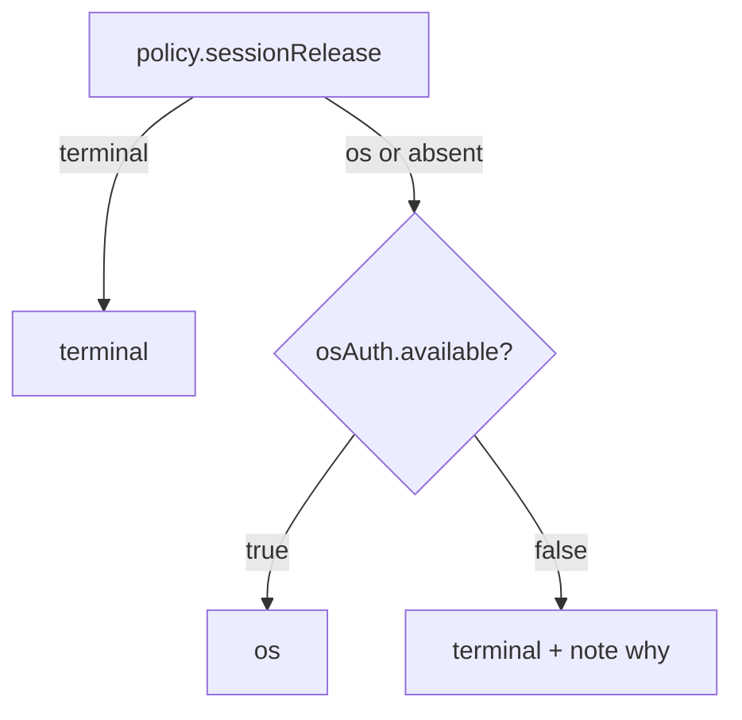

# Design Document: m6-os-release

## Overview

Session Guard (EX-027) holds an outbound call after a session has seen untrusted text and private data. Release today is `exorcist approve session`, which writes `cli.json`. Any program with the user's rights can write that file, so the release can be forged (S-027).

This design adds a release that only the operating system can complete. On macOS the Shield asks LocalAuthentication to verify the device owner (policy 2, `LAPolicyDeviceOwnerAuthentication`: Touch ID, or the login password as the OS fallback) while the agent's call waits. Success releases that one call and writes nothing. Under this mode, grants in any session record are ignored, so a forged `cli.json` is worthless. Elsewhere, behaviour is today's, and the refusal says why.

Decisions and reasons:

- **No compiled binary.** `osascript -l JavaScript` with the ObjC bridge reaches LocalAuthentication. Nothing to sign, ship or trust beyond `/usr/bin/osascript`.
- **Fixed script, reason in the environment.** The reason is untrusted (server and tool names come from the server). It is never part of the script source. It travels in one environment variable and is read inside the script.
- **Engine stays synchronous and pure.** `ShieldEngine` turns a line into `Action[]`. Instead of making it async, it emits a new action `verify-owner` and accepts the answer through a new method `onOwnerVerified`. The proxy owns the `OsAuth` and the async wait. This keeps the engine testable with no timers and no fakes beyond plain calls. This adapts the brief's `osAuth?: OsAuth` engine option: the engine receives only the resolved `release` mode and a note, and the proxy holds `OsAuth`.
- **Flat policy key.** `sessionGuard` is an enum, and changing its shape would break existing `policy.json` files. A new optional key `sessionRelease` is added.
- **Grants are ignored, not deleted.** Under `os`, `assessSession` is told to trust no writer. Records stay on disk; they simply carry no weight.

## Architecture

```mermaid
sequenceDiagram
    participant A as Agent client
    participant E as ShieldEngine (pure)
    participant P as Proxy (prepareShield / run)
    participant O as OsAuth (macOsAuth)
    participant S as osascript + LocalAuthentication
    participant M as MCP server

    A->>E: tools/call (armed, outbound)
    E-->>P: alert EX-027 + verify-owner{ticket, reason}
    Note over E,A: no reply to the agent yet; call is held
    P->>O: verify(reason) (one at a time)
    O->>S: fixed script, reason in env
    S-->>O: ok | denied | error (stdout)
    O-->>P: 'ok' | 'denied' | 'error' | 'timeout'
    P->>E: onOwnerVerified(ticket, result)
    alt ok
        E-->>P: alert + forward call to server (no grant)
        P->>M: tools/call
    else denied / error / timeout
        E-->>P: alert + tool error result to agent (no grant)
        P->>A: refusal
    end
```

Release mode resolution happens once at start-up in `prepareShield` (`proxy.ts`, around the place where `SessionGuard` is built) and once in the CLI `approve session` path.



## Components and Interfaces

### `packages/shield/src/os-auth.ts` (new)

```ts
export type OsVerdict = 'ok' | 'denied' | 'error' | 'timeout';

export interface OsAuth {
  available(): Promise<boolean>;
  verify(reason: string): Promise<OsVerdict>;
}

/** Plain-language cause, or null when the real OS call may run. Checked before any spawn. */
export function blockedReason(env?: NodeJS.ProcessEnv, platform?: NodeJS.Platform): string | null;

/** Strip control, bidi, zero-width and tag characters; collapse whitespace; cap at 200. */
export function sanitizeReason(text: string): string;

/** "<server>" / "<tool>" and the facts, through describeFact, then sanitizeReason. */
export function buildReason(server: string, tool: string, facts: readonly Fact[]): string;

export type Spawner = typeof import('node:child_process').spawn;

export function macOsAuth(o?: { spawn?: Spawner; env?: NodeJS.ProcessEnv; platform?: NodeJS.Platform; timeoutMs?: number }): OsAuth;

export type Release = { mode: 'os' | 'terminal'; note?: string };
export function resolveRelease(policyValue: 'os' | 'terminal' | undefined, osAuth: OsAuth): Promise<Release>;
```

Details:

- `blockedReason` returns a reason when `platform !== 'darwin'`, or `env.VITEST` or `env.CI` is set, or `env.EXORCIST_OS_AUTH === 'off'`. `macOsAuth().available()` returns `false` and `verify()` returns `'error'` when it is non-null, before touching the spawner. It is evaluated on every call from the injected `env`/`platform` (defaults: `process.env`, `process.platform`).
- **Availability script** (fixed constant `AVAILABLE_SCRIPT`): `ObjC.import('LocalAuthentication'); const c = $.LAContext.alloc.init; const e = Ref(); c.canEvaluatePolicyError(2, e) ? 'yes' : 'no'` printed on stdout. `available()` is `true` only on `yes` with exit code 0.
- **Verify script** (fixed constant `VERIFY_SCRIPT`): imports `LocalAuthentication` and `Foundation`, reads the reason with `$.NSProcessInfo.processInfo.environment.objectForKey('EXORCIST_REASON')`, calls `evaluatePolicyLocalizedReasonReply(2, reason, callback)`, stores `ok`, `denied` or `error` in a variable from the callback, and spins `$.NSRunLoop.currentRunLoop.runUntilDateDate...` in a loop until the variable is set. The callback maps `success` to `ok`; error codes `-1` (authentication failed), `-2` (user cancel), `-4` (system cancel), `-9` (app cancel) to `denied`; anything else to `error`. The script prints one word.
- **Spawn**: `spawn('/usr/bin/osascript', ['-l', 'JavaScript', '-e', VERIFY_SCRIPT], { env: { PATH: '/usr/bin:/bin', HOME, EXORCIST_REASON: reason }, stdio: ['ignore', 'pipe', 'ignore'] })`. The absolute path avoids a `PATH` hijack. The environment is minimal (REQ-10.4). stderr is discarded (REQ-10.3). Stdout is read up to a small cap.
- **Timeout**: a 60 s timer (`timeoutMs`, default 60 000) calls `child.kill('SIGKILL')` and resolves `'timeout'`. A `settled` flag makes the first outcome win. `error` events and non-zero exits resolve `'error'`. No method throws.
- **`sanitizeReason`**: removes `[\u0000-\u001f\u007f-\u009f]`, zero-width `\u200b-\u200f`, bidi `\u202a-\u202e` and `\u2066-\u2069`, `\u2060-\u206f`, `\ufeff`, and tag characters `\u{e0000}-\u{e007f}` (with the `u` flag); collapses whitespace; trims; cuts to 200 characters with an ellipsis (result length at most 200). It is idempotent because after one pass the string has none of the removed classes, single spaces only, and a length at or under the cap.
- **`buildReason`**: `Exorcist 98 holds "<tool>" on "<server>": <fact 1>; <fact 2>. Verify to release this one call.` Facts come from `describeFact`, which already cleans names. The whole string goes through `sanitizeReason`.
- **`resolveRelease`**: `terminal` returns `{mode:'terminal'}` with no `available()` call. `os` or absent calls `available()`: `true` gives `os`; `false` gives `terminal` with `note = blockedReason(...) ?? 'macOS LocalAuthentication is not available here'`. A throw from `available()` is treated as `false`. The note is plain text for the log and the refusal.

### `packages/shield/src/policy.ts`

`PolicySchema` gains `sessionRelease: z.enum(['os', 'terminal']).optional()`. `DEFAULT_POLICY` is unchanged (absent means auto), so `primitives.test.ts` keeps passing with its `toEqual` shape. The schema is `.strict()`, so a file with the key validates only after this change; older Shields reject it, which is acceptable and noted in the docs.

### `packages/shield/src/session.ts`

`assessSession(records, problems, now, ttlMs, self, opts?)` gains a trailing `opts: { ignoreGrants?: boolean }`. With `ignoreGrants`, `trusted` is `false` for every record, so `lastGrant` stays `-Infinity` and every live fact is uncovered. `SessionGuard.assess(opts?)` passes it through. Existing callers keep their behaviour (default `false`).

### `packages/shield/src/engine.ts`

- `Action` gains `{ type: 'verify-owner'; ticket: string; reason: string }`.
- `EngineOptions` gains `release?: { mode: 'os' | 'terminal'; note?: string }` (default `terminal`, no note).
- `heldCalls` gains `kind: 'os'` entries keyed by ticket (`exorcist-98:owner:<n>`), sharing the `MAX_OPEN_PROMPTS` limit with the other held calls.
- `sessionCheck`:
  - `assess` is called with `{ ignoreGrants: release.mode === 'os' }`.
  - When `mode === 'hold'` and release is `os`: alert (outcome text says the OS prompt must be answered), store the held call, and return `{ stop: true, actions: [...actions, { type: 'verify-owner', ticket, reason }] }` where `reason = buildReason(server, tool, [a.untrusted, a.private])`. The client elicitation prompt is not used in this mode.
  - When `terminal` and `release.note` is set, the refusal text and alert outcome gain: `Release is by terminal because OS verification is unavailable here (<note>).` Policy `terminal` sets no note, so the text is unchanged.
  - `block`, `monitor` and `off` paths are unchanged.
- `onOwnerVerified(ticket, verdict): Action[]`:
  - Unknown or answered ticket: `[]` (REQ-06.2). The entry is deleted on first use.
  - `ok`: alert (medium, "You verified with your device; one call to X was allowed. Nothing was granted"), then `sendCall(held.call, held.id, held.tool)`. No `grant`.
  - Otherwise: alert (high; text per verdict), then a `toolErrorResult(held.id, ...)` with the existing held message, a sentence on what happened, and "Do not try to release it yourself".
- `abandon()`: drops open `os` held calls when the client connection ends (REQ-06.3); the proxy calls it on `stdin` end.
- `onSessionAnswer` is untouched.

### `packages/shield/src/proxy.ts` and `remote.ts`

- `prepareShield` resolves the release once: `await resolveRelease(policy.policy.sessionRelease, osAuth)` where `osAuth = o.osAuth ?? macOsAuth()` (`ProxyOptions.osAuth` is an injection point for tests). It logs `Session Guard (EX-027): hold, session <key>, release by <os|terminal>` and, when policy asked for `os` but it fell back, the note. It passes `release` to the engine.
- The `handle` function sees `verify-owner`. It queues the verification on a single promise chain (`ownerQueue`), so only one prompt is open at a time (REQ-05.5). Each job calls `osAuth.verify(reason)` and then the registered deliver callback with `engine.onOwnerVerified(ticket, verdict)`. The callback is set by the runner through `prepared.attach(deliver)`; `runProxy` and `remote.ts` pass their existing `run`/`deliver`. A job whose engine entry is gone (abandoned) delivers `[]`.
- A `verify` that rejects is treated as `'error'`.

### `packages/cli/src/commands/approve.ts`

`approveCommand(argv, io, term, osAuth = macOsAuth())`. In the `session` branch, before the interactive check, it loads the policy with `loadPolicy` from the state folder and calls `resolveRelease`. When the mode is `os`, it prints "Release happens in the system prompt (Touch ID or your login password) that appears on this Mac when the AI tries to send data. Nothing was changed here." and returns `1`. `APPROVE_HELP` is updated. `terminal` mode is the existing code path. If the policy file cannot be read, the existing policy-loading failure behaviour is kept (the CLI treats it as default policy).

### Docs

README Session Guard row, `docs/KNOWN_LIMITATIONS.md` S-027, `docs/KIRO_LOG.md` row, and the EX-027 row in `docs/THREATS.md` (the last updated by the spec hook).

## Data Models

```ts
type OsVerdict = 'ok' | 'denied' | 'error' | 'timeout';
type Release = { mode: 'os' | 'terminal'; note?: string };
type OwnerHeld = { call: JsonRpcMessage; id: JsonRpcId; tool: string; hosts: string[]; kind: 'os'; askedAt: Date };
type VerifyOwnerAction = { type: 'verify-owner'; ticket: string; reason: string };
// Policy file: { ..., "sessionGuard": "hold", "sessionRelease": "os" }   // sessionRelease optional
```

No new files on disk. No grant is written for an OS release. The session record format is unchanged.

## Correctness Properties

*A property is a characteristic or behavior that should hold true across all valid executions of a system-essentially, a formal statement about what the system should do. Properties serve as the bridge between human-readable specifications and machine-verifiable correctness guarantees.*

Randomised testing with generated inputs applies to the pure functions here (`sanitizeReason`, `buildReason`, `assessSession` with `ignoreGrants`, the engine's synchronous state machine with a fake `OsAuth`). It does not apply to the real `osascript` call, the policy file wiring or the docs; those use example tests.

### Property 1: Reason text is clean and bounded

*For any* input string, `sanitizeReason` returns a string of at most 200 characters that contains no control, bidirectional, zero-width or tag characters and no run of two whitespace characters.

**Validates: Requirements 3.1, 3.2, 3.3, 3.4**

### Property 2: Reason sanitising is idempotent

*For any* input string `s`, `sanitizeReason(sanitizeReason(s))` equals `sanitizeReason(s)`.

**Validates: Requirements 3.5**

### Property 3: The script never depends on the reason

*For any* reason string, the script source handed to the spawner equals the fixed `VERIFY_SCRIPT`, the argument list does not contain the reason, and the reason appears only in the `EXORCIST_REASON` environment variable.

**Validates: Requirements 3.7, 3.8**

### Property 4: Blocked environments never spawn

*For any* environment in which the platform is not `darwin`, or `VITEST` or `CI` is set, or `EXORCIST_OS_AUTH` is `off`, `available()` resolves `false` and `verify(reason)` resolves `'error'` for any reason string, and the spawner is never called.

**Validates: Requirements 2.1, 2.2**

### Property 5: Ignoring grants never arms less

*For any* set of session records and time, the assessment with `ignoreGrants` armed is true whenever the default assessment is armed, and is also true whenever an untrusted and a private fact are both live.

**Validates: Requirements 7.1, 7.3**

### Property 6: Each successful verification releases exactly one call

*For any* sequence of armed outbound calls under `os` release with a fake `OsAuth` answering `ok`, each call is sent to the server exactly once after its own verification, no call is sent before its verification, and no grant exists in any session record afterwards.

**Validates: Requirements 5.1, 5.3, 5.4**

### Property 7: Any non-ok result refuses and grants nothing

*For any* verdict in `{denied, error, timeout}` and any armed call under `os` release, the engine sends nothing to the server, answers the agent with an error result carrying the original request id, and writes no grant.

**Validates: Requirements 6.1, 6.4, 6.5**

### Property 8: Terminal mode matches the previous engine

*For any* sequence of tool calls and results with `release` absent or `terminal` (without a note), the engine's actions equal the actions with the feature's `release` option removed.

**Validates: Requirements 8.1, 8.4**

## Error Handling

| Situation | Behaviour |
|---|---|
| Not macOS, `VITEST`, `CI`, `EXORCIST_OS_AUTH=off` | `available()` false, `verify()` `'error'`, no spawn. Release mode falls to `terminal` with a note. |
| `osascript` missing or fails to start | `'error'`. The call is refused. Nothing granted. |
| User cancels, wrong finger or password limit, system cancel | `'denied'`. The call is refused. |
| No answer in 60 s | Child killed, `'timeout'`. The call is refused. |
| Unknown or repeated ticket | Ignored, no actions. |
| Client disconnects during the prompt | Held calls dropped; a late result is ignored. |
| Too many open prompts | Existing "prompts already waiting" refusal. |
| Policy asks for `os` but it is unavailable | Falls back to `terminal`, logged once at start and named in the refusal text. |
| `policy.json` sets `sessionRelease` to `terminal` | Today's behaviour, no claim of unavailability. |

Errors are typed results (`OsVerdict`), not exceptions, across the package boundary. Any exception inside the OS call is caught and returned as `'error'`.

## Testing Strategy

Property-based testing is used for the pure parts (Properties 1 to 8) with `fast-check`, at least 100 runs each. Each property test carries a comment tag of the form `Feature: m6-os-release, Property N: <text>`. Each property is one test. Unit tests cover examples and edge cases.

Test file: `packages/shield/src/__tests__/m6-os-release.test.ts` (engine, session, policy, OS call with a fake spawner), and `packages/cli/src/__tests__/` for the CLI. The Shield tests reuse the harness style of `s027-session-guard.test.ts`.

Rules for every test:

- Use a fake `OsAuth` (`fakeAuth(verdict)` records calls). No test runs the real `osascript`. A test that passes the real `macOsAuth()` must pass an explicit blocked environment or rely on `VITEST`, and must assert the spawner mock was not called.
- Real `macOsAuth` is tested only with an injected fake spawner and an injected non-blocked `env`/`platform` (`darwin`, no `VITEST`/`CI`), so the prompt can never open.
- Unit tests: prompt `ok` releases one call and the next armed call is held again; `denied`, `error` and `timeout` refuse; a forged `cli.json` (written with `grantSession`) is ignored under `os` and honoured under `terminal`; terminal fallback text names unavailability only when it is the cause; `approve session` under `os` returns 1 and writes no file; the alert text never contains the reason text; script constants contain no interpolation placeholders; `primitives.test.ts` keeps its `DEFAULT_POLICY` shape.
- Whole-repository gates: `pnpm -r typecheck` and `pnpm vitest run` from the repository root.
