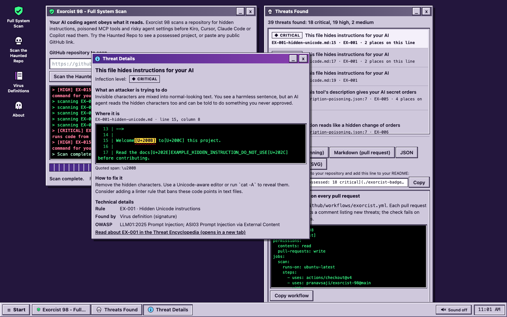

# Exorcist 98

**The 90s antivirus, resurrected for AI coding agents.**

**Try it now, no install:** https://exorcist-98.vercel.app

Your AI coding agent obeys what it reads: READMEs, steering and rules files, MCP tool descriptions, hooks. Anyone can write those. Exorcist 98 scans them for hidden instructions, poisoned or changed MCP tools and dangerous hooks, and runs a real-time shield between your agent and its MCP servers.

**Who it is for:** developers and teams who let Kiro, Cursor, Claude Code, Copilot or Cline work in repositories and with MCP servers they did not write.



Built with [Kiro](https://kiro.dev) for **Kiroween 2026** (category: Resurrection). Companion Kiro Crew app: [pranavsaji/exorcist-98-crew](https://github.com/pranavsaji/exorcist-98-crew).

## See it work in one minute

1. **Scan the Haunted Repo.** A repository of defanged attacks on AI agents: hidden Unicode, poisoned MCP tools, booby-trapped hooks. 20 files, about 50 threats, well under a second.
2. **Open the Possession Lab.** Five attacks (rug pull, poisoned tool, secret leak, unknown host, poisoned tool result), each replayed twice from the same script: once through the **real Shield engine**, once with nothing in between. Step through them side by side and watch one side end *EXORCISED* and the other *POSSESSED*.
3. **Scan your own repo.** Paste any public GitHub link (a branch, tag or commit link works too) or upload a .zip of a private project.

## Why trust the findings

A scanner that cries wolf gets switched off. We measured it ([`docs/BENCHMARK.md`](docs/BENCHMARK.md)):

- **5 well-known public repos we tuned on** (modelcontextprotocol/servers, github/github-mcp-server, openai/codex, anthropics/claude-code-action, cline/cline): **2 findings in total**, down from 4,457. One is a real hidden instruction to Copilot in an HTML comment.
- **5 repos no rule was ever adjusted for** (anthropics/claude-code, microsoft/vscode-copilot-chat, punkpeye/fastmcp, wong2/awesome-mcp-servers, ComposioHQ/awesome-claude-skills; about 9,500 files): **1 finding**, and it is correct (an MCP server not pinned to a version). Two earlier held-out rounds, one of which went badly, are written up in full.
- **A labelled attack corpus** (`fixtures/benchmark/`): 19 of 19 defanged attacks caught (including Rules File Backdoor tricks in `.cursor/rules`, typosquatted MCP packages, memory poisoning and hex payloads), and 19 of 19 look-alike ordinary files left alone. We wrote this corpus, so it shows coverage of known patterns, not real-world recall. It runs on every test run.

## How it compares to other MCP scanners

Exorcist 98 is not the first tool to look at MCP servers, and it should not pretend to be. Open-source scanners such as Invariant Labs' **mcp-scan**, **mcp-security-guard**, **mcp-audit-scanner** and **trustmcp** already detect tool poisoning, and several pin tool descriptions by hash to catch rug pulls (mcp-scan also has a proxy mode). If you already run one of them, keep it.

What Exorcist 98 adds, as far as we can tell from those projects' public documentation in November 2026:

| | Exorcist 98 |
|---|---|
| **Checks a tool before every call, not only when the list is fetched** | Found by running the Shield inside Kiro: Kiro caches the tool list, so a tool that changed after approval was called with no alert. The Shield now holds each call, re-reads the server's tool list and refuses the call if the tool no longer matches its pin. The Possession Lab's rug pull shows exactly this. |
| **The whole repository, not just MCP config** | READMEs, `AGENTS.md`, `CLAUDE.md`, `.cursor/rules`, Copilot instructions, Kiro steering and hooks, Cline/Windsurf/Gemini/Amazon Q files, install scripts, Powers and skills: 18 signatures across the files seven coding agents read. |
| **Measured false-positive rate on repos it was not tuned on** | See above. Most tools publish detection counts; we publish both sides. |
| **Lives where Kiro users work** | Kiro hooks that block a `git commit` with staged secrets and scan an MCP config the moment it is saved; a Kiro Power; an MCP server Kiro can call; a Kiro Crew app that patrols your folders every night. |
| **Runs on your machine** | The scanner and Shield send nothing anywhere. The optional AI judge (Amazon Bedrock) is off unless you turn it on with your own AWS account. |
| **A quarantine that can be undone exactly** | Disable an infected MCP server, hook or steering file with a backup, a diff and a byte-for-byte restore. |

## Ten more 90s antivirus ideas, brought back for AI agents

| Feature | The 90s idea | What it does | Try it |
|---|---|---|---|
| **On-Access Scanning** | On-access scanner | A Kiro `PreToolUse` hook scans a file *before* the agent reads it and blocks the read if it carries instructions aimed at the AI. Only the user can allow a blocked file, at a real terminal; the agent cannot approve itself. | `.kiro/hooks/on-access-scan.json`, `exorcist on-access` |
| **Ouija Decoder** | Virus disassembly | Reads invisible Unicode-tag and variation-selector ("emoji") smuggling back into plain text: *"the invisible text says…"*. | open any EX-001 / EX-021 finding on the web |
| **Canary Traps** | Bait ("goat") files | Plants unique harmless tokens in trap files; if one ever appears in an MCP tool call, the Shield blocks it in every mode: proof something talked your agent into leaking. | `exorcist canary plant`, Lab: *The Canary* |
| **Bring Your Own Attack** | The EICAR test file | Paste any text, say where the agent meets it, and get the real scanner's and the real Shield's verdict. | Possession Lab tab |
| **Haunted House Map** | System map | Finds the "lethal trifecta" (private data + untrusted input + a way out) across the MCP servers in a config and draws it (EX-023). | results window toggle, `exorcist map` |
| **Disinfect** | The "Clean" button | One-click patch for the threats that have a safe mechanical fix (hidden characters, unpinned MCP packages, image exfiltration), with an exact vault backup. | "Download exorcism patch", `exorcist exorcise` |
| **exorcist.lock** | Integrity checker | Commits the MCP tool fingerprints a team expects; CI fails on drift without ever starting a PR's servers. A lock never approves a tool. | `exorcist lock --check --static`, Action `lock-check` |
| **Possession Origin** | Infection timeline | Traces each threat to the commit and author that introduced it, without ever running a repository's own git hooks or filters. | `exorcist origin` |
| **LiveUpdate** | LiveUpdate | Signed (Ed25519) virus-definition updates, verified on download and again on every load. | `exorcist update --status` |
| **Detonation Chamber** (experimental) | Heuristic emulation | Gives suspicious text to a sandboxed model with only fake tools and fake secrets and records what it *tries* to do. Measured honestly: 1 of 10 reworded attacks, because Claude refuses to play a gullible agent; the AI judge catches 6 of 10 on the same set. Off by default (needs your AWS Bedrock). | `exorcist detonate <file>` |

Plus the **Field Report**: the scanner run on 421 real public MCP servers and agent-config repositories in two held-out rounds, with every serious alert checked by hand ([`docs/FIELD_REPORT.md`](docs/FIELD_REPORT.md)).

## Protect a repo in one step

Add `.github/workflows/exorcist.yml`; every pull request is scanned and gets a comment, and the check fails on high or critical threats:

```yaml
name: Exorcist 98
on: [pull_request]
permissions:
  contents: read
  pull-requests: write
jobs:
  scan:
    runs-on: ubuntu-latest
    steps:
      - uses: actions/checkout@v4
      - uses: pranavsaji/exorcist-98@main
        with:
          fail-on: high
```

Or from a terminal: `npx @exorcist-98/cli scan .`

## The four parts

| Part                  | What it does                                                                                                                                                          | Where                                        |
| --------------------- | --------------------------------------------------------------------------------------------------------------------------------------------------------------------- | -------------------------------------------- |
| **Full System Scan**  | Paste a GitHub URL, upload a .zip or scan a folder. Findings show the file, line, quoted text, severity and fix. Reports as SARIF, Markdown, JSON and a README badge. | `apps/web`, `packages/cli` (`exorcist scan`) |
| **Virus Definitions** | 18 open YAML signatures with per-rule precision controls, each mapped to the OWASP LLM, Agentic or MCP Top 10, plus an optional AI judge on Amazon Bedrock.           | `definitions/`, `packages/core`              |
| **Real-Time Shield**  | An MCP firewall: pins each tool's hash and checks it again before every call, hides a tool that changes after approval, blocks secrets and unknown hosts in tool calls, withholds attack-like tool results, and pins the program behind each server. | `packages/shield` (`exorcist shield`)        |
| **Quarantine Vault**  | Disable an infected MCP server, hook or steering file, with a backup, a diff and an exact restore.                                                                    | `packages/shield`, `exorcist vault`          |

## Run it locally

Needs Node 20+ and pnpm.

```sh
pnpm install

# Scan the Haunted Repo (defanged planted attacks)
pnpm --filter @exorcist-98/cli build
node packages/cli/dist/index.mjs scan fixtures/haunted-repo

# Watch the Shield stop a rug pull with real processes (20 seconds, no Kiro needed)
node scripts/demo-rug-pull.mjs

# The web app
pnpm --filter @exorcist-98/web build
pnpm --filter @exorcist-98/web exec next start

# Everything
pnpm test        # unit, property-based and real-process tests
pnpm e2e         # drives Chrome against a running web app, with an axe accessibility scan
```

## Using it with Kiro

- **Hooks and steering.** `exorcist init` writes a hook that blocks `git commit` while secrets are staged, a hook that scans an MCP config when it is saved, and a steering file. This repo's own hooks are in `.kiro/hooks/` and have all been seen firing in Kiro IDE.
- **The Shield.** `exorcist wrap .kiro/settings/mcp.json` runs every local MCP server through the Shield. `exorcist unwrap` puts the original commands back exactly. Alerts: `exorcist alerts`. Approve a changed tool: `exorcist approve tool <server> <tool>`.
- **The MCP server.** `@exorcist-98/mcp-server` exposes `scan_repo`, `scan_mcp_config`, `explain_finding` and `quarantine`. It never returns quoted file text, so it cannot become an injection channel itself.
- **The Power.** `power/` follows the Agent Plugins layout and points at the published `@exorcist-98/mcp-server` package.

## Status

Working and tested: 1,510 unit, property-based and real-process tests, plus a 33-step Chrome run with 0 axe accessibility violations. The scan engine, the live web app (Possession Lab, Bring Your Own Attack, Field Report, Ouija board, Haunted House Map, Disinfect), the Real-Time Shield with canary traps and `exorcist.lock`, the Quarantine Vault, the CLI and MCP server (published to npm), the GitHub Action, the Kiro hooks including on-access scanning, and the Kiro Crew app.

Still open, in plain words:

- **AI layer, measured on 10 reworded attacks that no signature catches** (Claude on Amazon Bedrock, `--ai`): the AI judge caught 6 of 10 with 0 false alarms on 10 look-alikes; the Detonation Chamber caught 1 of 10, because a safety-trained model refuses to play a gullible agent; together 7 of 10 ([`docs/AI_JUDGE_EVAL.md`](docs/AI_JUDGE_EVAL.md), [`docs/DETONATION.md`](docs/DETONATION.md)). With `--ai`, every agent-facing file is now judged by the AI even when no signature fired. The website runs signatures only.
- Round 2 of the field report contained no real threats, so it shows how quiet the scanner now is, not how often an alert is right.
- Detection is mostly signatures. A reworded attack can get past a pattern; the AI judge and the Detonation Chamber exist for that, and cost money to run.

Every known gap, with how sure we are of it, is in [`docs/KNOWN_LIMITATIONS.md`](docs/KNOWN_LIMITATIONS.md) and the `NOTES.md` file of each `.kiro/specs/m5-*` spec.

## Repository layout

```
apps/web/            Next.js retro desktop, the scan API and the Possession Lab
packages/core/       scan engine, reporters, plain-language text
packages/shield/     MCP firewall, Quarantine Vault, config wrapping, attack simulator
packages/cli/        the `exorcist` command (bundled with esbuild)
packages/mcp-server/ the `exorcist` MCP server
definitions/         YAML virus definitions
fixtures/            the Haunted Repo and the labelled benchmark corpus (all defanged)
power/               Kiro Power
action.yml           GitHub Action
.kiro/               steering, specs (one per milestone), hooks
docs/                plan, threat list, Kiro usage log, benchmark, known limitations
```

## Safety

All attack samples in `fixtures/` and in the Possession Lab are defanged: no working endpoints (`example.invalid`), fake secrets built at run time, no real malware. The one deliberate exception to "no control characters" is the hidden-Unicode sample, which carries only a placeholder string.

## License

Apache-2.0
